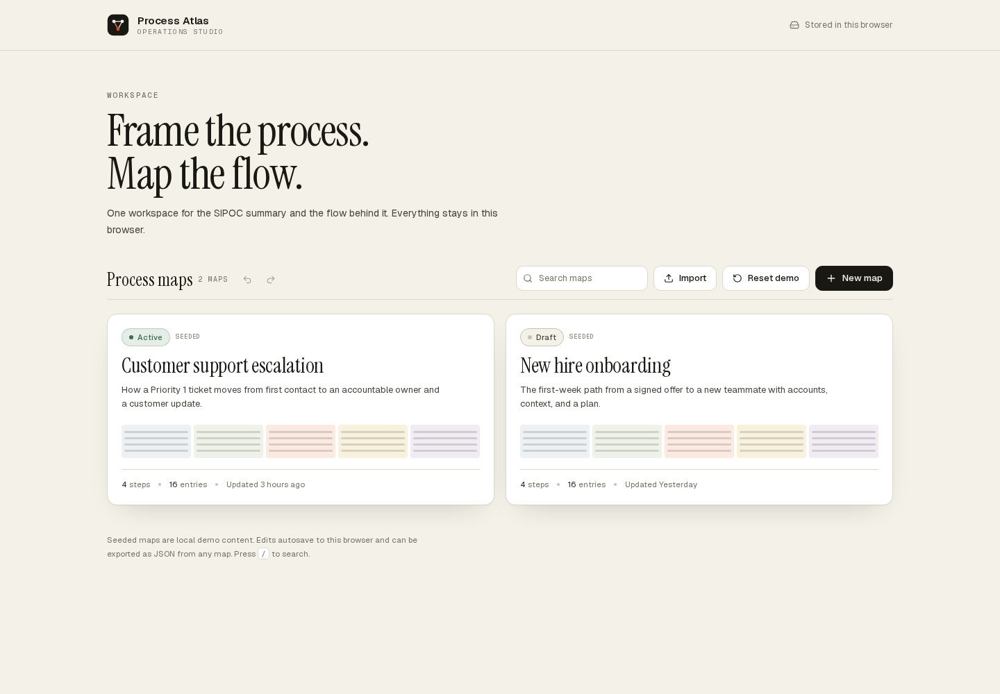
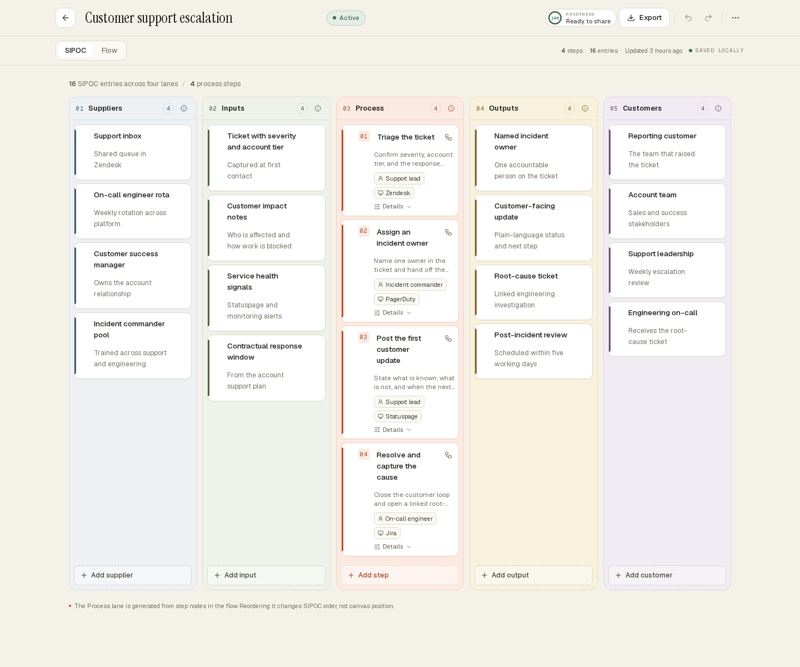
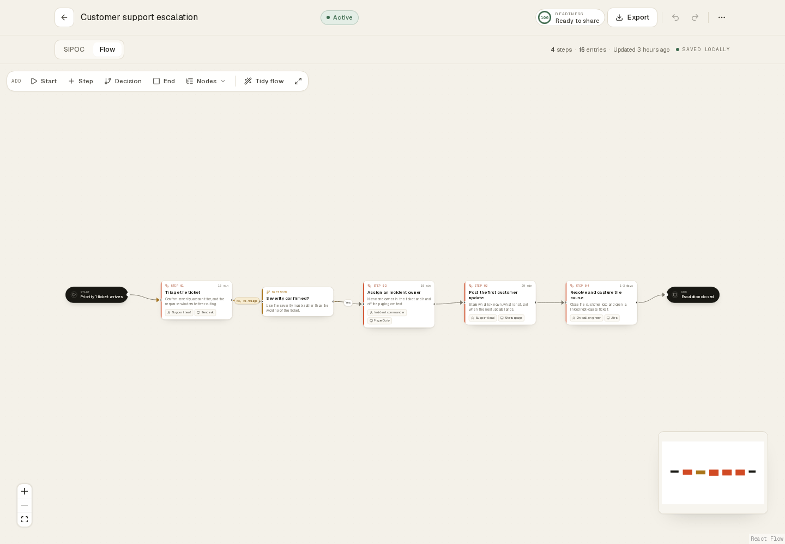
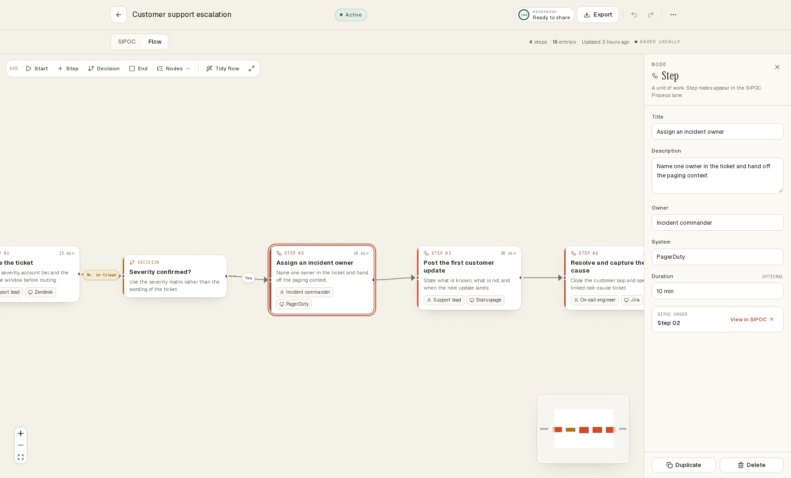
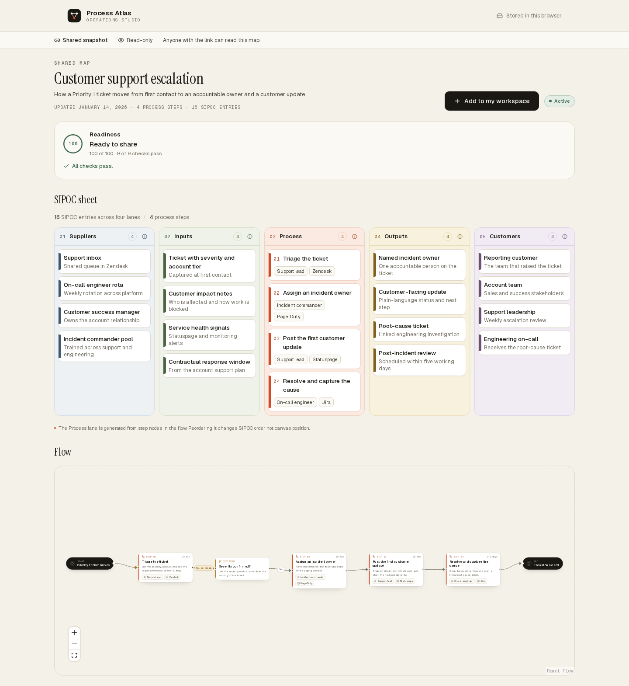
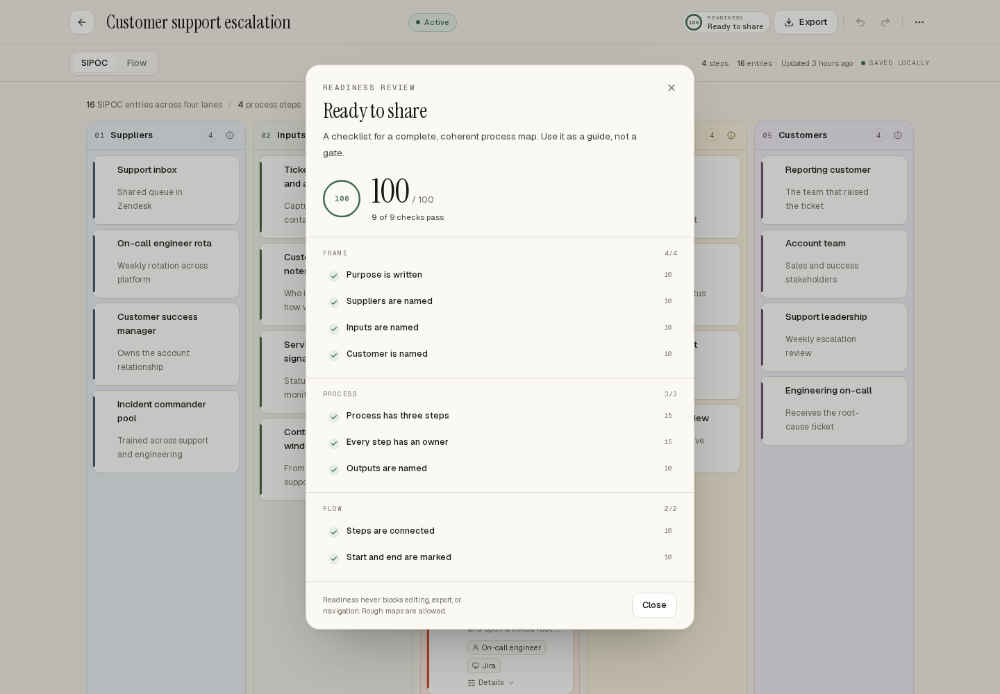
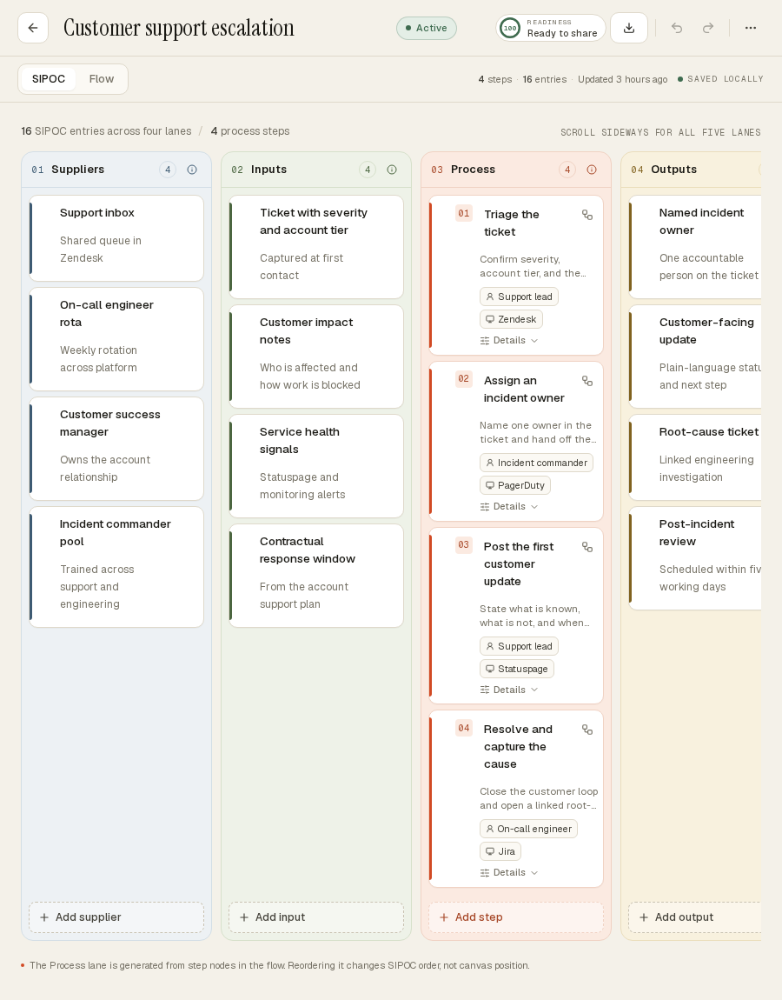
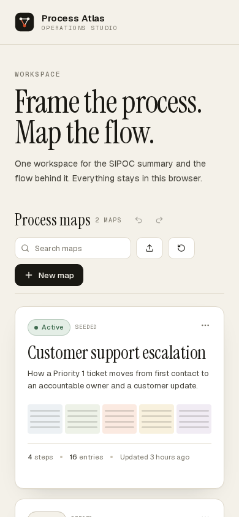

# Process Atlas

[**Open the live demo →**](https://gerrcass.github.io/process-mapper/)

A local-first SIPOC and process-mapping workspace. Frame a process as a five-lane SIPOC sheet, map the flow behind it, and leave with something you can share — a read-only link, a JSON export, or a printed sheet. No account, backend, or runtime configuration.

[](https://gerrcass.github.io/process-mapper/)

## The idea

Process work often splits into a static SIPOC slide, a separate flow diagram, and a document that goes stale. Process Atlas keeps them in one document. The SIPOC sheet and the flow graph are two views of the same process map, so a rename, reorder, or deletion reaches both.

The workspace opens with two complete seeded maps:

- **Customer support escalation** — a Priority 1 ticket from first contact to customer update and root-cause review.
- **New hire onboarding** — a signed offer through first-week orientation and a 30-day plan.

Three templates are available for new maps: support escalation, new hire onboarding, and purchase order approval, plus a blank option. They are available from the dashboard gallery and the New map dialog.

## Two views, one document

```text
ProcessMap
├── sipoc
│   ├── suppliers   entries
│   ├── inputs      entries
│   ├── outputs     entries
│   └── customers   entries
├── nodes           start | step | decision | end
│                   position, owner, system, duration, SIPOC order
├── edges           source, target, label, flow | exception
└── viewport        pan and zoom
```

The flow graph owns process steps. The **SIPOC Process lane is derived** by filtering nodes with `kind === "step"` and sorting by SIPOC order. There is no second step collection to synchronize. Start, decision, and end nodes stay in the flow and never appear in the SIPOC summary.

Canvas position and SIPOC order are deliberately independent. Dragging a node changes layout. Reordering the Process lane changes the summarized sequence without moving the canvas. **Tidy flow** reconciles the two with a deterministic layered layout.



## What is in the product

- **Workspace** — seeded maps, search across titles and descriptions, recent-first order, status pills, step and entry counts, duplicate and confirmed delete.
- **Template gallery** — three complete starting points plus a blank map, available directly from the dashboard.
- **SIPOC editing** — inline add, label and detail editing with Enter or blur to commit and Escape to cancel, drag reordering, arrow-key reordering, deliberate delete, contextual examples in empty lanes.
- **Process steps** — add from the SIPOC Process lane, edit title, description, owner, system, and duration, reorder without moving the canvas, jump to the node in the flow.
- **Flow canvas** — pan, zoom, fit view, minimap, custom start, step, decision, and end nodes, labelled flow and exception edges, connect by handle, delete with clear feedback, empty-flow starting action.
- **Inspector** — title, description, owner, system, duration, duplicate and delete for nodes; label, kind, and delete for edges. A side panel on desktop and a sheet on narrow screens.
- **Tidy flow** — dependency-ranked columns that handle cycles and disconnected components and never touch SIPOC order.
- **Readiness** — an advisory 0–100 score with nine weighted checks grouped into Frame, Process, and Flow. Failed checks link back to the relevant lane or flow.
- **Undo and redo** — workspace-wide history with buttons and keyboard shortcuts. A canvas drag is one history step. History is in memory and starts empty on reload.
- **Data portability** — JSON export and validated import with fresh identities, `(imported)` collision names, and actionable errors; high-resolution flow PNG; a dedicated five-lane print stylesheet.
- **Share links** — a read-only snapshot of one map carried in the URL fragment, readable by anyone with the link. Copy a link from the editor, send it, and the recipient can read the SIPOC, the flow, and the readiness summary before adopting the snapshot into their workspace.
- **Resilience** — versioned schema, validation at every boundary, corrupt-payload quarantine, storage-failure banner, missing-map and empty-workspace states, error boundary.
- **Accessibility** — labelled controls, visible focus, keyboard lane reordering, arrow-key and drag paths, dialogs from Radix primitives, reduced-motion support.







## Readiness

Readiness is a score plus a checklist, never a gate. The seeded support map scores 100. Emptying a lane, removing an owner, or disconnecting a step flips the matching check and subtracts exactly that weight.

| Check                    | Weight | Passes when                                              |
| ------------------------ | -----: | -------------------------------------------------------- |
| Purpose is written       |     10 | Description has at least 20 characters                   |
| Suppliers are named      |     10 | At least two suppliers                                   |
| Inputs are named         |     10 | At least two inputs                                      |
| Process has three steps  |     15 | At least three step nodes                                |
| Every step has an owner  |     15 | Each step has an owner                                   |
| Outputs are named        |     10 | At least two outputs                                     |
| Customer is named        |     10 | At least one customer                                    |
| Steps are connected      |     10 | Every step has an incident edge, or the map has one step |
| Start and end are marked |     10 | At least one start and one end node                      |



## Stack

- Next.js 16 App Router, React 19, TypeScript strict
- Tailwind CSS v4 with CSS-variable design tokens
- Zustand for the workspace store, persisted to `localStorage`
- Zod for runtime validation of documents and persisted payloads
- `@xyflow/react` (React Flow 12) for the flow canvas
- `@dnd-kit` for sortable SIPOC lanes
- Radix UI primitives, Sonner toasts, Lucide icons
- `html-to-image` for flow PNG export
- Vitest, Testing Library, Playwright

## Run it

```bash
pnpm install
pnpm dev
```

Open [http://localhost:3000](http://localhost:3000).

| Command             | Does                                |
| ------------------- | ----------------------------------- |
| `pnpm dev`          | Development server                  |
| `pnpm build`        | Production build                    |
| `pnpm start`        | Serve the production build          |
| `pnpm lint`         | ESLint                              |
| `pnpm typecheck`    | `tsc --noEmit`                      |
| `pnpm test`         | Vitest in watch mode                |
| `pnpm test:run`     | Unit and component tests once       |
| `pnpm test:e2e`     | Playwright journeys                 |
| `pnpm build:static` | Static export for GitHub Pages      |
| `pnpm verify`       | Lint, typecheck, tests, both builds |
| `pnpm format`       | Prettier                            |

No `.env` file is needed.

## Testing

Tests sit at the seams where the product can fail without a browser:

- **Domain** (`src/domain/*.test.ts`) — entry and step CRUD, SIPOC reordering, edge validation, readiness weights and boundaries, Tidy flow with cycles and disconnected components, schema validation, import/export shape and identity regeneration, share-link encoding, decoding, and the size budget.
- **Store** (`src/store/workspace.test.ts`) — create, duplicate, delete, import, adopt, reset, undo/redo, drag transactions, valid hydration, corrupt-payload fallback, newer-schema rejection.
- **Components** — inline SIPOC edits and keyboard reordering, process step edits, inspector fields through to SIPOC, readiness dialog, dashboard search, new-map validation, share dialog, shared view.
- **Browser** (`e2e/journeys.spec.ts`) — cross-view edits surviving a reload, template lifecycle with delete and JSON import, corrupt storage and empty flow, a broken share link naming its reason, reading and adopting a shared snapshot before editing it, and phone-width usability.

```bash
pnpm exec playwright install chromium
pnpm test:e2e
```

CI runs lint, typecheck, unit/component tests, the server build, the static export, and the browser journeys. `pnpm verify` covers everything except the Playwright journeys.

## Architecture

```text
src/
├── app/                 routes, metadata, favicon, OG image, error and not-found
├── domain/              types, Zod schema, pure map operations
│   ├── layout.ts        deterministic Tidy flow
│   ├── readiness.ts     weighted score and checklist
│   ├── templates.ts     three templates and two seeded maps
│   ├── import-export.ts JSON parsing and filenames
│   └── share-link.ts    fragment payload codec for share links
├── store/workspace.ts   Zustand store, history, validated persistence
├── components/
│   ├── dashboard/       workspace, map cards, dialogs
│   ├── sipoc/           five-lane board, lanes, entry and step cards
│   ├── flow/            React Flow adapter, nodes, edges, inspector
│   ├── share/           the read-only view behind a share link
│   └── readiness/       header ring and review dialog
└── lib/                 time, download, export image, keyboard hooks
```

The domain layer is pure and React-free. Components call store actions; they do not assemble documents or mutate nested objects. React Flow types stay in the flow adapter and never enter the domain model.

Persistence is hydration-safe. The store uses `skipHydration`, the app renders a stable skeleton until rehydration finishes, and no `localStorage` is read during render. Every persisted payload is validated before it reaches the store. Invalid or newer payloads fall back to the seeded workspace, keep the bad payload as a backup, and surface a dismissible notice.

See [ADR-0001](docs/adr/0001-local-first-persistence.md), [ADR-0002](docs/adr/0002-flow-graph-owns-process-steps.md), and [ADR-0003](docs/adr/0003-share-links-carry-the-snapshot-in-the-fragment.md) for the three decisions that shape the app.

## Local-first caveat

Maps live in the `localStorage` of one browser profile. There is no sync, account, or server copy. Clearing site data, using a private window, or switching browsers loses the workspace unless you export the map as JSON first. Export is the backup path; import restores a map with a fresh identity.

The app quarantines an unreadable payload under `process-atlas.workspace.corrupt` and restores the seeded maps rather than crashing.

## Share links are snapshots

A share link carries the map as it was when the link was copied. It never updates, and anyone with the link can read the map — the share dialog and the shared view both say so. Re-share after editing, and use the JSON export for a map too large to fit in a link. The snapshot travels in the URL fragment, so no server ever sees it; see [ADR-0003](docs/adr/0003-share-links-carry-the-snapshot-in-the-fragment.md).

## Screenshots

| Desktop workspace                               | Flow inspector                                            |
| ----------------------------------------------- | --------------------------------------------------------- |
|  |  |

| Tablet SIPOC                                          | Phone workspace                                             |
| ----------------------------------------------------- | ----------------------------------------------------------- |
|  |  |

A print-ready SIPOC sheet is in [docs/screenshots/08-print-sheet.png](docs/screenshots/08-print-sheet.png).

The shared view opened from a share link is in [docs/screenshots/09-shared-view.png](docs/screenshots/09-shared-view.png).

## Deployment and GitHub Pages

The live demo runs on GitHub Pages: **https://gerrcass.github.io/process-mapper/**

The app has no server-side data or secrets. The editor uses a single static `/maps?map=<id>` route, and share links carry their snapshot in the `#shared=` fragment of that route, so the whole workspace exports to plain HTML, CSS, and JavaScript and the host never receives a shared map. The workflow in `.github/workflows/deploy-pages.yml` runs on every push to `main`, builds with the repository base path, and deploys `out/`.

For a local production server:

```bash
pnpm build
pnpm start
```

The Pages build is the same app with static export enabled. Reproduce it locally with:

```bash
pnpm build:static
```

The workflow supplies `PAGES_BASE_PATH` and `NEXT_PUBLIC_SITE_URL` from the Pages environment, so metadata and Open Graph assets resolve against the deployed origin. No runtime environment variables are needed for local development.

## Scope

Intentionally out of scope for this demo: accounts, teams, shared workspaces, server storage, real-time collaboration, comments, AI generation, BPMN or Miro import, attachments, dark mode, native apps, i18n, and analytics.
